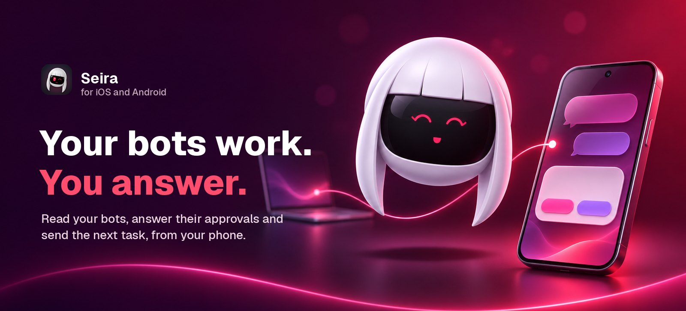
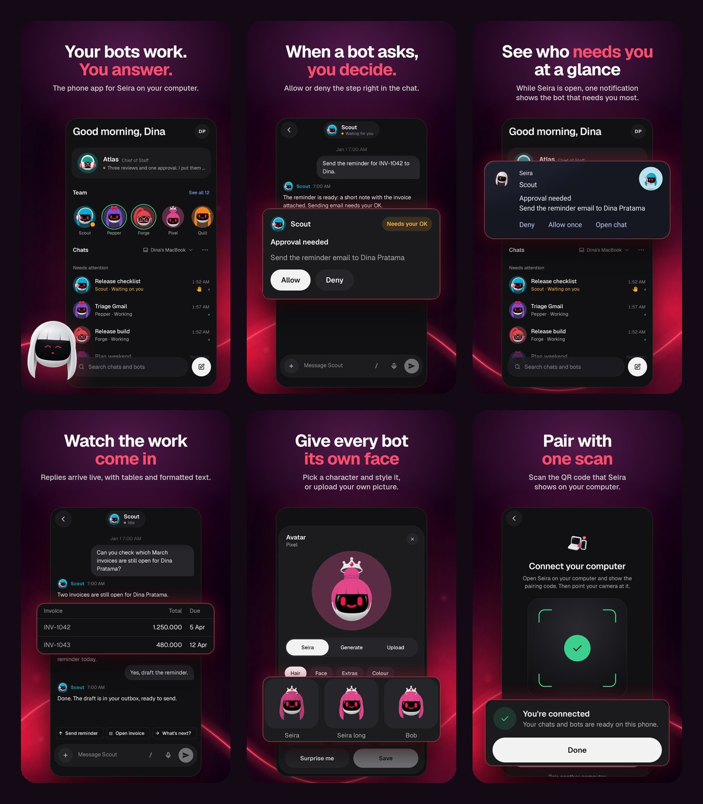
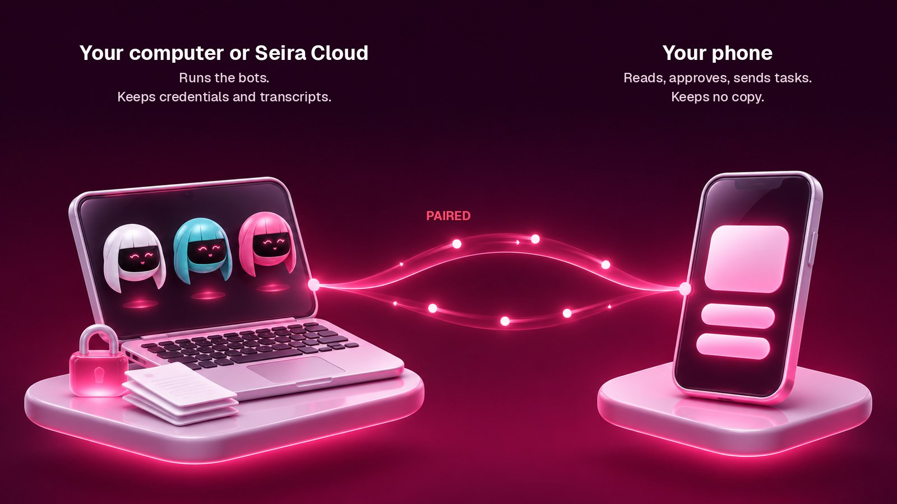

<p align="center">
  
</p>

<p align="center">
  <a href="https://play.google.com/store/apps/details?id=bot.seira.companion"></a>
  <a href="https://github.com/seira-bot/seira"></a>
</p>

<p align="center">
  
  
  
  
  <a href="LICENSE"></a>
</p>

# Seira mobile

The iOS and Android apps for [Seira](https://github.com/seira-bot/seira).
Pair a phone with a computer or a Seira Cloud. Then read your bots, answer
their approvals, and send them the next task from the phone.

## What the app does

| Feature | What you do |
|---|---|
| **Answer approvals** | When a bot asks, allow or deny the step in the chat. |
| **See who needs you** | One notification shows the bot that needs you most. |
| **Watch the work come in** | Replies arrive live, with tables and formatted text. |
| **Give each bot a face** | Pick a character and style it, or upload your own picture. |
| **Pair with one scan** | Scan the QR code that Seira shows on your computer. |
| **Share to a bot** (iOS) | Send text, links, images and files from other apps. |
| **Widgets** (iOS) | See the bots that wait on you from the Home Screen. |

<p align="center">
  
</p>

## How it works

<p align="center">
  
</p>

The computer keeps the bots, credentials and transcripts. The phone keeps no
copy of them.

## Status

The code comes from the companion apps as they were on 2026-10-06, with
their full history. App names, store IDs and icons are Seira. Internal code
names (Swift and Kotlin types, packages, the Android `namespace`, the
XcodeGen project) keep their old names. The apps read both the OpenMausBot
and the Seira protocol identifiers: the pairing URL scheme, the pairing token,
the well-known path and the health app id. They send the OpenMausBot
identifiers, including the mDNS service name, until a later desktop release.

## Layout

| Folder | Contents |
|--------|----------|
| `ios/` | SwiftUI app, share extension, widgets, `CompanionCore` Swift package |
| `android/` | Kotlin and Compose app (`:app`) and protocol module (`:core`) |
| `docs/verification/` | Manual and simulator check lists for each app |
| `scripts/` | iOS string and view checks, leak check, git hooks |

## Build

<table>
<tr><th>iOS</th><th>Android</th></tr>
<tr valign="top"><td>

Needs macOS, Xcode and [XcodeGen](https://github.com/yonaskolb/XcodeGen).

```sh
cd ios
xcodegen generate
open OpenMausCompanion.xcodeproj
```

</td><td>

Needs JDK 17 and an Android SDK.

```sh
cd android
./gradlew :core:test \
  :app:testDebugUnitTest \
  :app:assembleDebug
```

</td></tr>
</table>

More detail is in [`ios/README.md`](ios/README.md), [`ios/TESTING.md`](ios/TESTING.md)
and [`android/README.md`](android/README.md).

## Protocol

The apps talk to the Seira server. The wire contract lives in the main repo:
`packages/phone-protocol` and `server/testing/fixtures/phone-jobs.json` in
[seira-bot/seira](https://github.com/seira-bot/seira).

Both apps test against captured server responses in
`ios/Tests/CompanionCoreTests/Fixtures/`. To refresh them, run
`scripts/capture-companion-fixtures.mjs --out <folder>` in a Seira clone.

## Git hooks

Turn on the leak check once per clone:

```sh
git config core.hooksPath scripts/git-hooks
```

## License

Seira mobile is source-available under the [PolyForm Shield License 1.0.0](LICENSE).
You can read, change and use the code, also in your company.
You cannot use it in a product that competes with Seira.
The code from before the license change on 2026-11-27 stays under the [Apache License 2.0](LICENSE-APACHE).
[`LICENSING.md`](LICENSING.md) tells which code is which, and [`NOTICE`](NOTICE) lists the third-party parts.

## Contributing

Agree to the [contributor license agreement](CLA.md) before you send a pull request.
