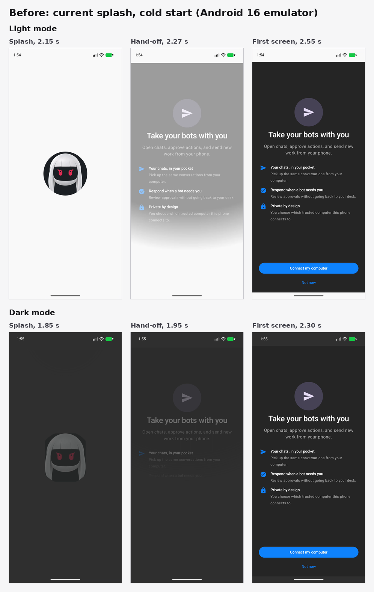
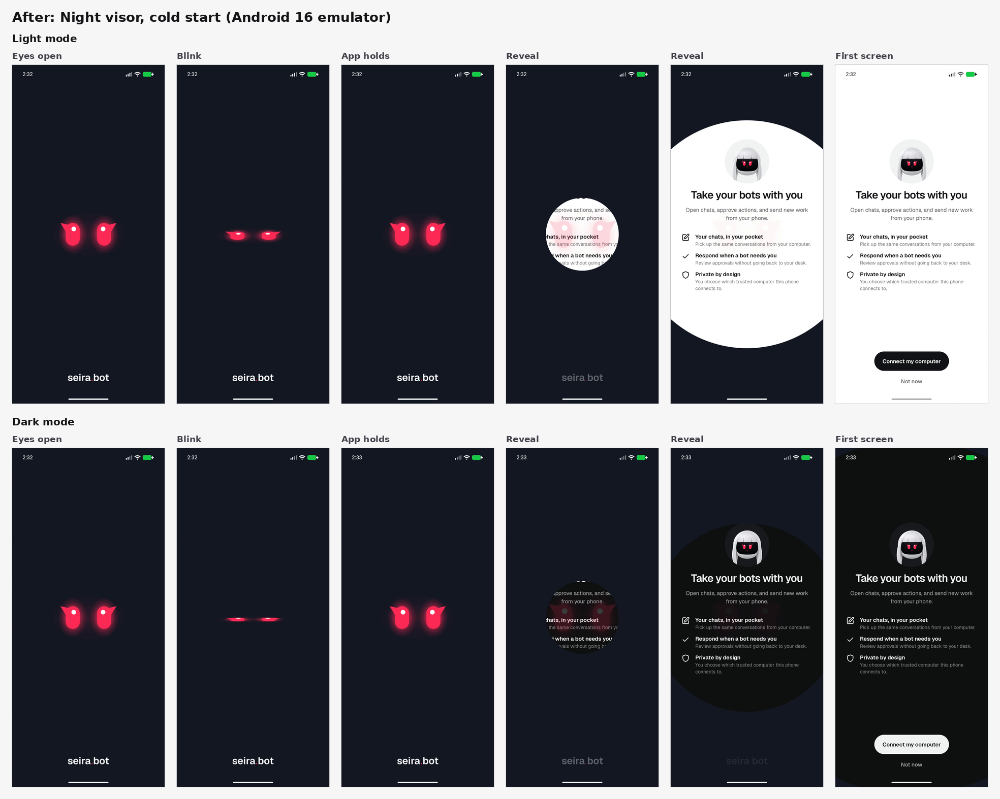

# Night visor launch (Android and iOS)

The app opens on visor ink in light and dark mode. The Seira eyes open, blink once, and a circle opens from the eyes to show the first screen.

## What the launch does

- Android 12 and later: the system splash shows the eyes on ink with the Seira wordmark at the bottom. The eyes open and blink in 800 ms.
- Android 8 to 11: the compat splash shows the same eyes, open, on ink. The overlay fades the wordmark in.
- When the system splash ends, the app draws the same eyes at the same blink phase. Then the app removes the system splash in the same frame.
- The launch waits for the saved pairing state, for no more than 2000 ms after launch.
- Then a circle opens from the centre in 450 ms. The eyes grow by 25 % and fade in 250 ms. The wordmark fades in 200 ms.
- A launch from a notification or a link opens the circle at once.
- An activity that the system recreates with saved state shows no launch overlay.
- When the system turns animations off, the eyes stay open and the overlay fades in 200 ms.
- iOS: the launch screen shows the eyes on ink. The first view shows the wordmark, blinks once, and opens the same circle.

## Assets

`scripts/export-splash-visor.py` writes every splash asset from one geometry. Run it with the wordmark SVG from the brand kit:

```bash
python3 scripts/export-splash-visor.py --wordmark <path to seira-wordmark-reversed.svg>
```

| Asset | Path |
|-------|------|
| Static eyes (compat splash and overlay) | `android/app/src/main/res/drawable/ic_seira_splash.xml` |
| Animated eyes (Android 12 and later) | `android/app/src/main/res/drawable/ic_seira_splash_animated.xml` |
| Wordmark | `android/app/src/main/res/drawable/seira_splash_branding.xml` |
| Ink | `android/app/src/main/res/values/colors_splash.xml` |
| iOS eyes, ink, wordmark | `ios/App/Assets.xcassets/LaunchEyes.imageset`, `LaunchBackground.colorset`, `LaunchWordmark.imageset` |

## Covered by unit tests

```bash
ssh <host> 'bash -lc "cd <repo>/android && systemd-run --user --scope -q -p MemoryMax=8G -p MemorySwapMax=0 ./gradlew --no-daemon --max-workers=4 :app:testDebugUnitTest --tests \"*LaunchVisor*\""'
```

`LaunchVisorTimelineTest` (11 tests) proves the lid keyframes, the reveal rules (fast launch, blink end, wait cap), the reveal start and end values, the splash start in wall-clock and uptime time, the one-step clock for a long frame, the status bar switch late in the reveal, and that the first `start` call wins.

## Check on an emulator (Android 16)

1. Install the debug build: `adb install -r app/build/outputs/apk/debug/app-debug.apk`.
2. Set the mode: `adb shell cmd uimode night no` (or `yes`).
3. Stop the app: `adb shell am force-stop bot.seira.companion`.
4. Record: `adb shell screenrecord --size 720x1600 /sdcard/launch.mp4`, and in a second shell start the app:

```bash
adb shell am start --splashscreen-show-icon -W -a android.intent.action.MAIN -c android.intent.category.LAUNCHER -n bot.seira.companion/bot.seira.companion.MainActivity
```

5. Pull the video and step through it at 20 frames a second. No frame between the splash and the first screen may be white or black.

## Screenshots

Cold start on an Android 16 emulator, light and dark mode, two runs each. Every frame from the launcher to the first screen was checked. No frame is white or black.

Before: the white splash (light) or grey splash (dark) shows the head in a circle, then the first screen cuts in.



After: the eyes open and blink on ink, the app holds the same frame, and a circle opens to the first screen. The status bar takes the first-screen style at the end of the reveal.


